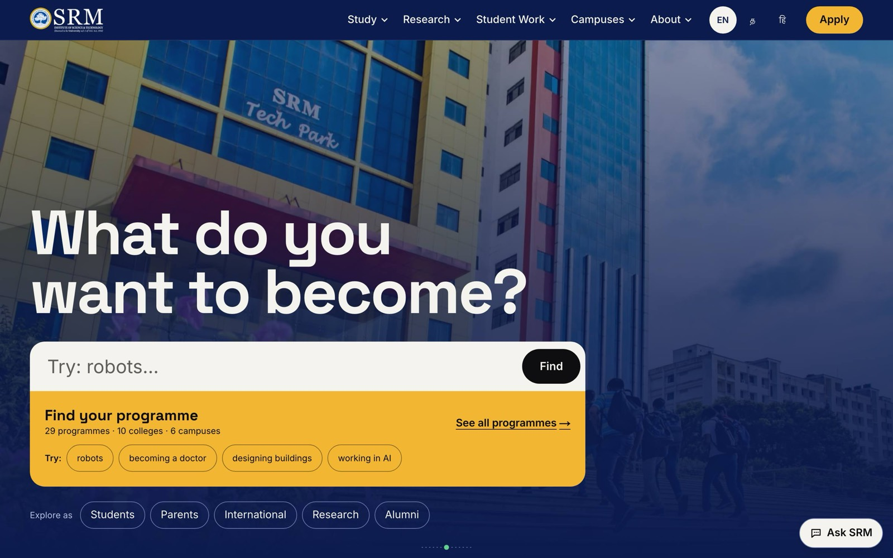
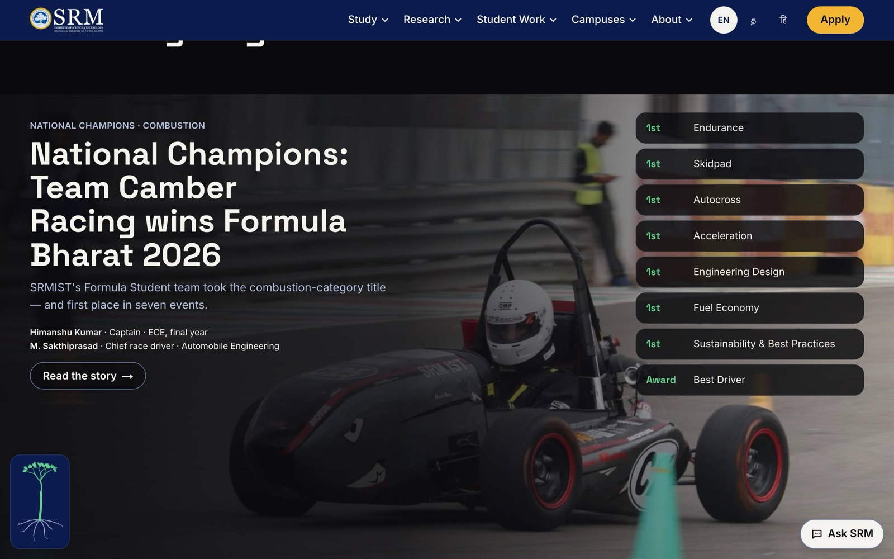
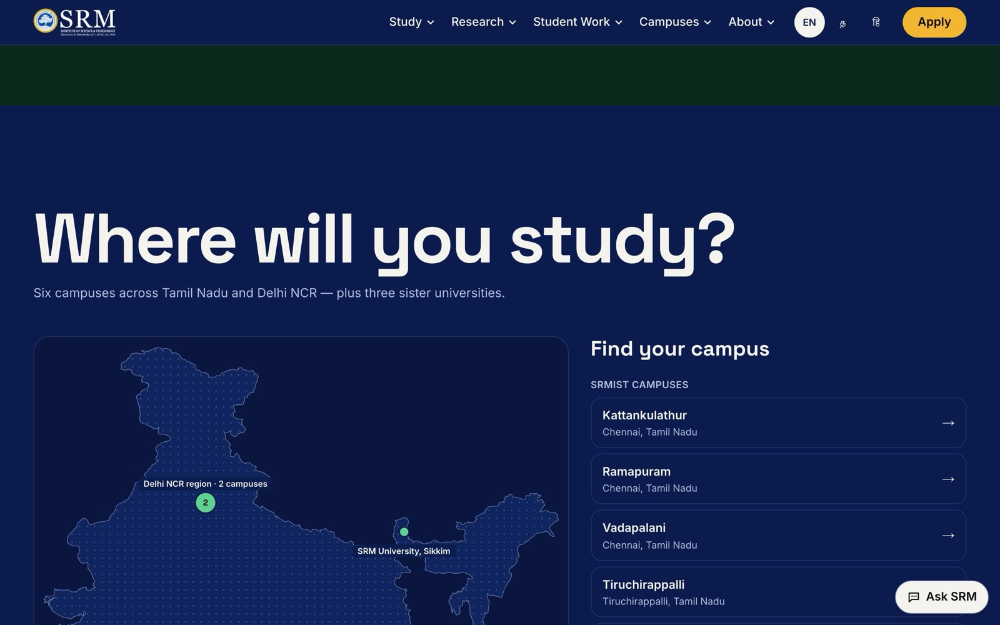
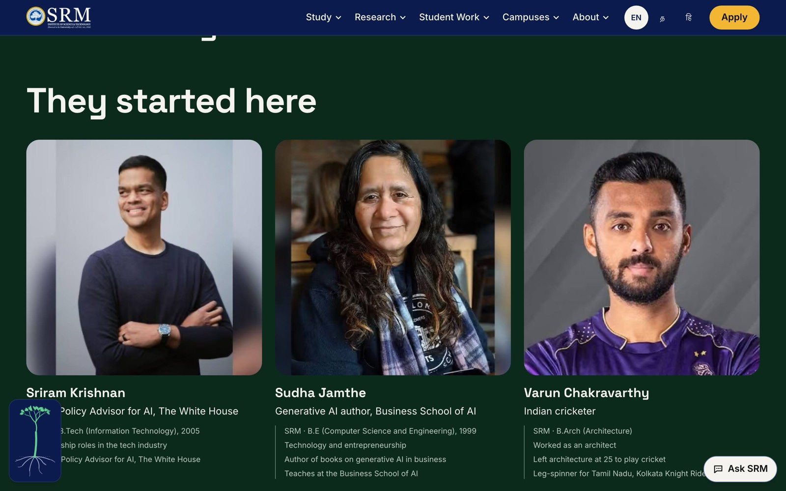
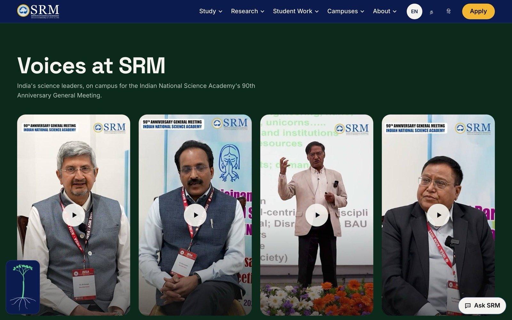
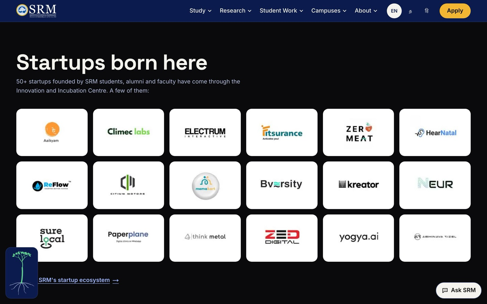
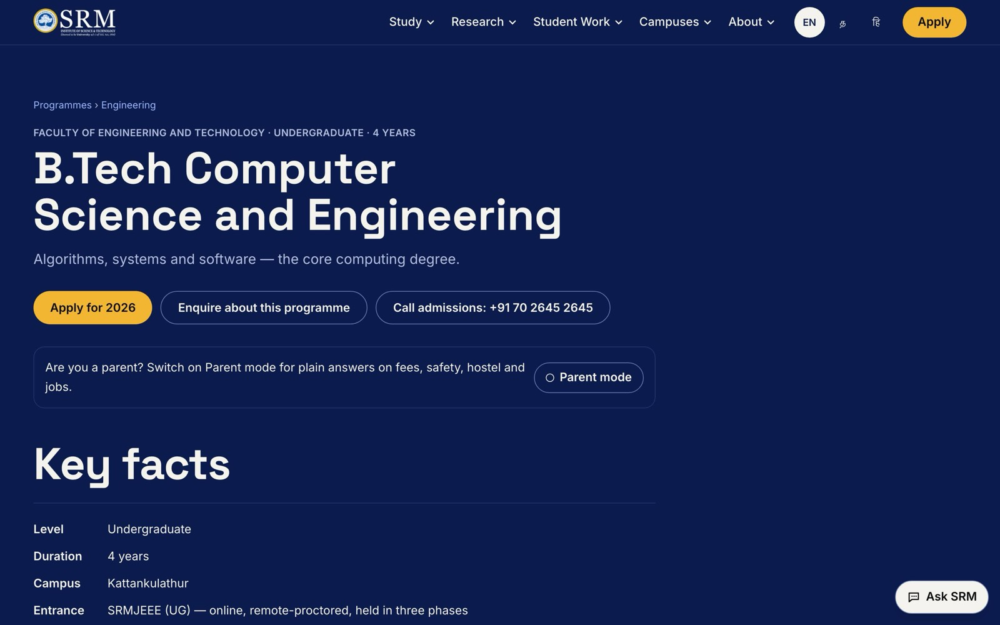
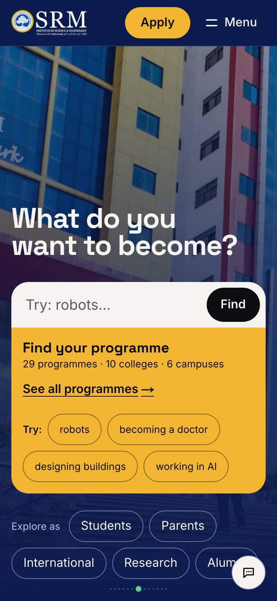
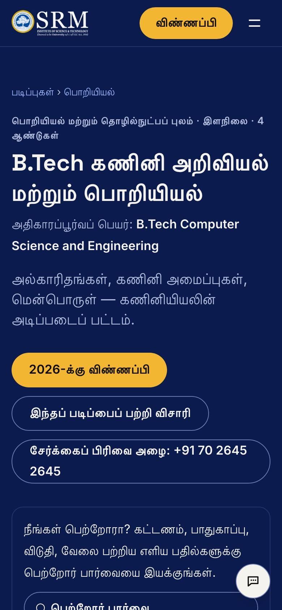

# SRM Institute of Science and Technology — Next-Gen Website Redesign

**Redesigned by Shreyas** ([@shreyascode11](https://github.com/shreyascode11)) · An entry for the *Next-Gen SRM Website Design Challenge*

A redesign of [srmist.edu.in](https://www.srmist.edu.in/) built around SRM's own tagline, **Learn. Leap. Lead.** The homepage is a three-act scroll, and a living tree grows as you read. Underneath, it is a fast, accessible site in English, Tamil and Hindi, built so that a parent on a budget Android phone can find B.Tech CSE fees in a few taps.

> This is an independent design-challenge entry, not the official SRM website. Facts, fees and dates come from SRM's published pages (see [Content you can trust](#content-you-can-trust)); always confirm admissions details with SRM.



---

## Highlights

| | |
|---|---|
| **Search is the front door** | Type "robots", "becoming a doctor" or "எனக்கு ரோபோக்கள் பிடிக்கும்", and matching programmes appear instantly with their fees and the words they matched. Press **Find** for answer cards with fees, eligibility and entrance details taken straight from SRM's data. |
| **Three acts, one story** | *Learn* (colleges and rankings), *Leap* (student work, startups, research by mission), *Lead* (alumni, leaders on campus, placements). Act titles assemble from fragments, and curtain wipes move between acts. |
| **Real 2026–27 facts** | Eligibility, entrance exams and 2026 last dates for 29 programmes, and annual fees for every one except MBBS (SRM hasn't published it), from SRM's 2026 admission pages and 2026–27 brochure, each with its source link. |
| **Command palette** | Press ⌘K or Ctrl+K, or tap the search icon, for one box covering every programme, page and action: call admissions, switch language, Parent Mode, Lite Mode. It works in all three languages and from the keyboard alone. |
| **Compare programmes** | Pin up to three programmes and see fees, eligibility, entrance and deadlines side by side, with what differs picked out. Each comparison is a link you can share, and it works without JavaScript. |
| **Ask SRM** | A free, rule-based assistant on every page. It answers from verified content only: fees, campuses, hostels, deadlines. When it doesn't know, it says so and offers the admissions phone numbers. No paid AI, and nothing is invented. |
| **Parent Mode** | One toggle rewrites any programme page into plain answers about cost, safety, hostel, distance from Chennai and jobs, with large *Call admissions* buttons. |
| **Lite Mode** | Switches on automatically for Save-Data, slow 3G or reduced motion. It strips video, 3D and smooth scrolling and keeps all the information. |
| **Three languages** | English, தமிழ் and हिन्दी, including programme names, fees and the assistant. Tamil and Devanagari use the fonts already on the device, so most phones download no extra font. |
| **Campus map and 360° tour** | A stylised India map with all six campuses and three sister universities, at their true coordinates. Tap a pin to fly in and get directions. For Kattankulathur, SRM's 360° tour opens without leaving the page. |
| **Hostels, in full** | Every girls', boys' and international block with photos, room types and warden contacts. Also the 2026–27 fee tables, how to apply, mess timings and canteens, safety rules for parents, and the hostel office contacts. All of it comes from SRM's hostel pages and fee circulars. |
| **Student life** | All eleven of SRM's student-life pages in one place: the green campus, student affairs and fests, 15 clubs, counselling with the counsellors' numbers, community centres, places of worship and the Equal Opportunity Cell. Anti-ragging helplines and penalties are one tap away for parents. |
| **Research centres and patents** | All ten central research labs and facilities (IIISM, REACH, NRC, CACR, the SRM-DBT Platform, Medical Research, Statistics, the Earthquake Research Cell, HPCC and SCIF), each with a brief, focus areas, facilities and who to contact. Also SRM's patent register: granted patents by country, the US patents and technology transfers. |
| **Voices and startups** | Talks by India's science leaders (DRDO, ISRO, INSA, NITI Aayog) play only when tapped. A logo wall shows startups from SRM's incubation centre. |
| **Ask a Senior** | Moderated Q&A with current students on each programme page. Sample data, with the real moderation states. |

## Screenshots

| Act II: Team Camber Racing, National Champions | Explore: campuses at their true locations |
|---|---|
|  |  |
| **Act III: alumni as people, not a logo wall** | **Voices at SRM: tap-to-play talks** |
|  |  |
| **Startups born here** | **Programme page with key facts and Parent Mode** |
|  |  |

<p align="center">
  
  &nbsp;&nbsp;
  
</p>

## Performance and accessibility

Measured on a production build with Lighthouse (mobile, simulated slow 4G, median of 3 runs) on 2026-10-26:

| Page | Performance | Accessibility | Best Practices | SEO | CLS |
|---|---|---|---|---|---|
| Homepage (English) | 94 | 100 | 100 | 100 | 0 |
| Homepage (Tamil) | 94 | 100 | 100 | 100 | 0 |
| B.Tech CSE programme page | 96 | 100 | 100 | 100 | 0 |

- **Every page** (all 147 sitemap URLs across the three languages) passes axe-core (WCAG 2.2 AA) at 360 px wide. No page scrolls sideways, each has exactly one `h1`, and none logs a console error.
- **Keyboard:** a skip link comes first, and every interactive element has a visible focus ring. Focus never lands behind the sticky header, and there are no keyboard traps.
- **JavaScript:** 136 kB on first load (budget 180 kB). The motion library, smooth scrolling, search index and YouTube player all load later, or only when used.
- **Reduced motion:** everything is static, nothing is pinned, and the tree appears fully grown.

The full audit and the fixes it led to are in [docs/AUDIT.md](docs/AUDIT.md).

## Tech stack

- **Next.js 15** (App Router) with **TypeScript** (strict mode) and **React 19**
- **Tailwind CSS v4**, with design tokens as CSS variables
- **GSAP + ScrollTrigger** for scroll choreography and **Lenis** for smooth scroll, both loaded after page load and switched off in Lite Mode
- **next-intl** for English, Tamil and Hindi
- **Fuse.js** for instant client-side search
- **next/image** for every image, served as AVIF or WebP; **next/font** for self-hosted fonts
- Deploy target: **Vercel**

## Getting started

```sh
npm install
npm run dev          # http://localhost:3000
```

| Command | What it does |
|---|---|
| `npm run build` | Production build; runs the content checks first |
| `npm run lint` / `npm run typecheck` | ESLint (zero warnings allowed) and the TypeScript compiler |
| `npm run check:content` | Validates every content file: references, TODO format, stats and translation coverage |
| `npm run media:status` | Lists every photo and video the site expects and marks which have arrived |
| `npm run i18n:review` | Exports every Tamil and Hindi string to `docs/translation-review.csv` for a native-speaker review |
| `npm run build:verify` / `npm run start:verify` | Builds and serves into `.next-verify/`, so a running `npm run dev` is never disturbed |

No API keys are needed. The site, the search, the programme matcher and the assistant all work offline. Two optional settings:

- `NEXT_PUBLIC_SITE_URL`: the canonical site address, for the sitemap and SEO tags.
- `ENQUIRY_WEBHOOK_URL`: where the admission enquiry form sends submissions. Without it, the form tells the visitor plainly that nothing was sent.

## Project structure

```
app/[locale]/        pages: home, programmes, programme detail, campuses, stories, admissions
app/api/             ask (programme matcher), assistant (Ask SRM), enquiry, search index
components/          hero, acts, map, nav, footer, programme, assistant, ui
content/             programmes, colleges, campuses, alumni, stories, research, stats, voices, startups (JSON)
content/i18n/        Tamil and Hindi translations of the content
messages/            interface text in en / ta / hi
lib/                 content loading, search, matcher, assistant, Lite Mode, Parent Mode, map maths
public/media/        photos (sources listed in content/media-credits.json)
scripts/             content checks, media status, map builders, translation review
docs/                audit, translation review, screenshots
```

## Content you can trust

- **Every fact has a source.** Fees, eligibility, entrance exams and dates come from SRM's 2026 admission pages and its 2026–27 brochure. Each programme lists its sources.
- **Unknown means TODO, never a guess.** Anything SRM hasn't published (for example MBBS fees, which appear only in the NEET bulletin) stays a marked `TODO`. It shows in development and is hidden on the live site.
- **Photos are real.** They are SRM's own, from its websites, plus openly licensed photos from Wikimedia Commons, which show their author and licence on the image. Every file's origin is listed in [`content/media-credits.json`](content/media-credits.json).
- **The demo walkthrough** for judges is in [DEMO.md](DEMO.md).

## Credits

**Design and development: Shreyas** — [github.com/shreyascode11](https://github.com/shreyascode11)

The SRM name, logo, emblem and photographs belong to SRM Institute of Science and Technology and are used here only for this design-challenge entry. Photos from Wikimedia Commons are credited on the images under their CC BY / CC BY-SA licences. Map data © OpenStreetMap contributors; India outline from Natural Earth (public domain).
